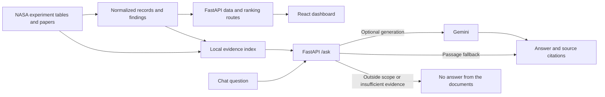
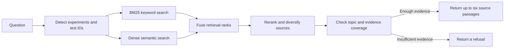

# Flame in Freefall

**Explore what NASA's microgravity combustion experiments can tell us about spacecraft fire safety.**

Team **Glitxh** · NASA International Space Apps Challenge 2026

How does a flame behave when buoyancy-driven convection is reduced? Which spacecraft fire tests best match a given oxygen level and cabin pressure? Flame in Freefall brings NASA experiment records, interactive charts, and a chat assistant with citations into one workspace.

[Run locally](#run-locally) · [Try the demo](#try-the-demo) · [Explore the data](#data-and-provenance) · [Understand the retrieval pipeline](#how-chat-finds-evidence)

| Measurement rows shown in Data | Source-checked findings | Investigations |
| ---: | ---: | ---: |
| **2,000** | **891** | **24** |

## Try the demo

1. **Ask a research question.** Try “What smoke concentration triggered the alarm in SAFFIRE IV?” Hover over the citation to see the source and check the measurement against the original context.
2. **Explore a cabin scenario.** From Chat, use the right arrow to open Dashboard. Set oxygen and pressure, then switch between **Prevention** and **Detection** to see how the SAFFIRE rankings change.
3. **Follow the evidence.** Use **Data** to find a test, **Plot** to chart two measurements, and **Findings** to read the research takeaways. Use **Compare** to put ranked tests side by side.
4. **Open the 3D view.** From Chat, use the up arrow. Rotate the view to inspect SAFFIRE tests by pressure, oxygen concentration, and peak carbon monoxide increase.

| Dashboard view | What you can do |
| --- | --- |
| **Ranking** | Find SAFFIRE IV–VI tests that match the scenario and inspect the score breakdown. |
| **Map** | See the scenario alongside tests in oxygen–pressure space. |
| **Plot** | Pick two measurements for a scatter plot. A test appears when it has values for both axes. |
| **Data** | Filter individual records by experiment, search text, oxygen, and pressure. |
| **Findings** | Read interpreted findings and open the associated investigation. |
| **Compare** | Inspect selected SAFFIRE tests side by side. |

## Run locally

Use **Python 3.12** and **Node.js 22** with npm. If you haven't cloned the repository yet:

```bash
git clone https://github.com/8Glitchh/flame-in-freefall.git
cd flame-in-freefall
```

Run the two services in separate terminals from the repository root.

### Backend

On Linux or macOS:

```bash
cd backend
python3.12 -m venv .venv
.venv/bin/python -m pip install -r requirements.txt
.venv/bin/python -m uvicorn app:app --port 8000
```

On Windows PowerShell:

```powershell
cd backend
py -3.12 -m venv .venv
.\.venv\Scripts\python.exe -m pip install -r requirements.txt
.\.venv\Scripts\python.exe -m uvicorn app:app --port 8000
```

The first startup downloads retrieval models and embeds the source passages. This can take several minutes. Later runs reuse embeddings in `rag/.cache/`. Wait for the backend to report startup complete, then open [FastAPI's interactive API docs](http://localhost:8000/docs).

### Frontend

```bash
cd frontend
npm ci
npm run dev
```

Open [the app on localhost:5173](http://localhost:5173). The frontend expects the API on port 8000.

### Optional Gemini responses

Chat works without a key by showing an excerpt from the highest ranked source when retrieval finds enough evidence. To enable generated answers, create `.env` at the repository root and fill in these settings:

```dotenv
LLM_BASE_URL=https://generativelanguage.googleapis.com/v1beta/openai
LLM_MODEL=your-enabled-gemini-model-id
LLM_API_KEY=your-gemini-api-key
```

Choose a model available to your project and keep the key in the local, ignored `.env` file. The backend appends `/chat/completions` to the base URL and sends the selected thinking level as `reasoning_effort` when one is chosen. A failed model call falls back to a source excerpt. [Google's Gemini compatibility guide](https://ai.google.dev/gemini-api/docs/openai)

## How the app fits together



The frontend uses React and Vite, Recharts for the scatter plot, and Three.js for the 3D view. FastAPI serves the structured records and rankings. Search runs locally, with the optional model receiving the question and retrieved passages for answer generation.

## How ranking works

The default score allocates 100 points across three components:

```text
Maximum points per component   (each block = 5 points)

Oxygen match      █████████   45
Pressure match    ███████     35
Hazard indicator  ████        20
```

Oxygen and pressure matches decrease linearly with distance from the scenario. The oxygen component reaches zero at a difference of 12 percentage points, and the pressure component reaches zero at 7 psi. The hazard component uses measured flame spread or flame-length growth for **Prevention** and time to alarm for **Detection**. It scales each measurement against the highest value used by the ranker for that mode.

The dashboard can reweight these components and rescales the total to a maximum of 100. Higher scores surface tests that fit the scenario and selected priority. Use the scores to prioritize source review. Engineering decisions require the original experimental conditions and independent validation.

## How chat finds evidence



The index includes papers, documents, spreadsheets, test records, and findings. Keyword retrieval helps with exact terms and test IDs. Semantic retrieval uses BGE embeddings to match related wording. A MiniLM cross-encoder reranks the candidates when available, and source diversification limits how many passages one document can contribute. The API returns source filenames and page numbers when the indexed passage has page information.

## Data and provenance

| File or folder | Contents |
| --- | --- |
| [`data/psi_tests_clean.csv`](data/psi_tests_clean.csv) | Normalized test records with measurement fields, source references, and flags. Of 2,016 CSV rows, 2,000 are marked as data and exposed in the dashboard. |
| [`data/investigations.csv`](data/investigations.csv) | Investigation IDs, names, and metadata. |
| [`data/findings/`](data/findings) | Source-checked findings CSV and investigation summaries. |
| [`data/papers/`](data/papers) | Research PDFs, documents, and spreadsheets. |
| [`data/experimental_tables/`](data/experimental_tables) | Experiment tables used to explore the underlying measurements. |
| [`data/background.md`](data/background.md) | Source inventory and notes on the NASA material. |

The app preserves source file and row references for dashboard measurements. Some measurements are missing or approximate, so the number of tests available for a plot depends on the axes and filters. Pressure is stored in kPa and converted to psi for display where applicable.

Browse the original investigation records in the [NASA Physical Sciences Informatics repository](https://psi.nasa.gov/physci/repo/).

## API reference

| Route | Purpose |
| --- | --- |
| `GET /data` | Dashboard measurement rows with units and provenance fields. |
| `GET /tests` | Tests with numeric oxygen and pressure values, filterable by range. |
| `GET /experiments` | Investigations with optional category and fuel filters. |
| `GET /experiments/{psi_id}` | Investigation metadata, tests, and findings. Also accepts an acronym. |
| `GET /findings` | Findings with optional theme, investigation, and featured filters. |
| `POST /rank` | Rank SAFFIRE tests using `o2` in percent, `psi` in psi, and `need` as `prevention` or `detection`. |
| `POST /ask` | Answer a `question` with citations. Accepts optional `thinking` and `shown` story IDs. |

## Verify a local build

From the repository root on Linux or macOS:

```bash
# Production frontend build
npm --prefix frontend run build

# Retrieval benchmarks (no Gemini key required)
backend/.venv/bin/python rag/rag.py
backend/.venv/bin/python rag/rag.py heldout

# Inspect the six passages retrieved for a question
backend/.venv/bin/python rag/rag.py search "What triggered the smoke alarm in SAFFIRE IV?"
```

On Windows, use `backend\.venv\Scripts\python.exe` for the Python commands. The retrieval benchmarks report expected evidence found at rank one and in the top six, plus expected refusals. They check retrieval through matching source text, so evaluate generated answers and their citations separately.

## Credits and license

Built by **Team Glitxh** for the 2026 NASA International Space Apps Challenge. The project code is distributed under the [MIT License](LICENSE). The original research and experimental data are credited to NASA and the researchers identified in the source documents.
