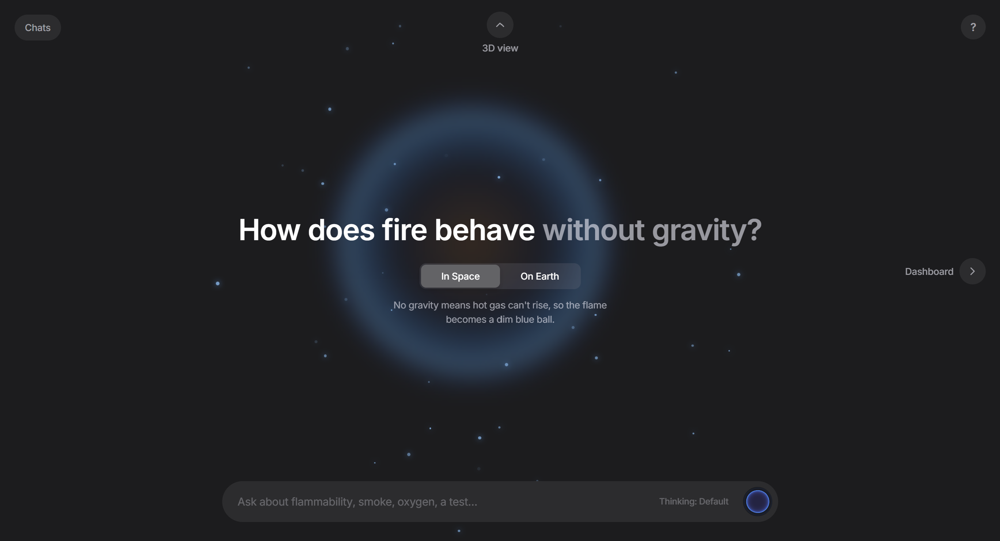
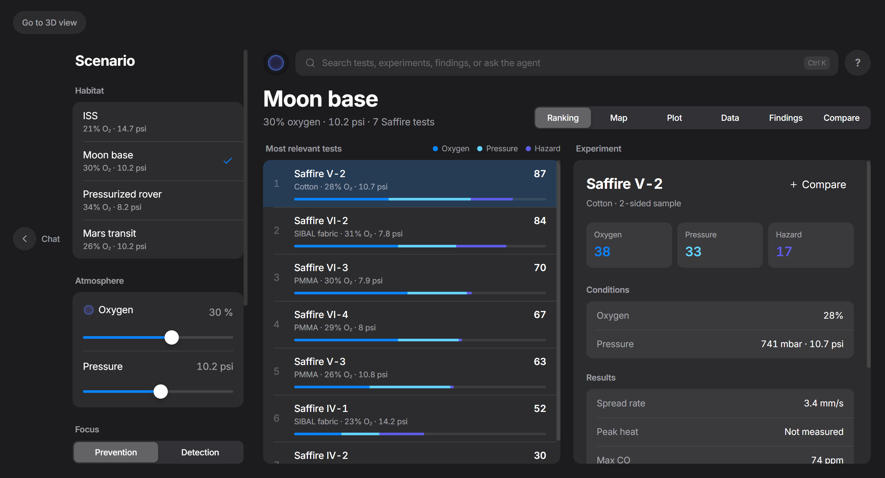
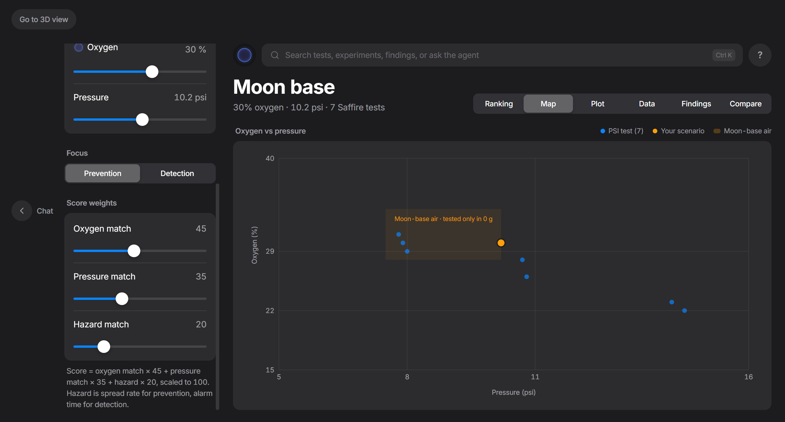
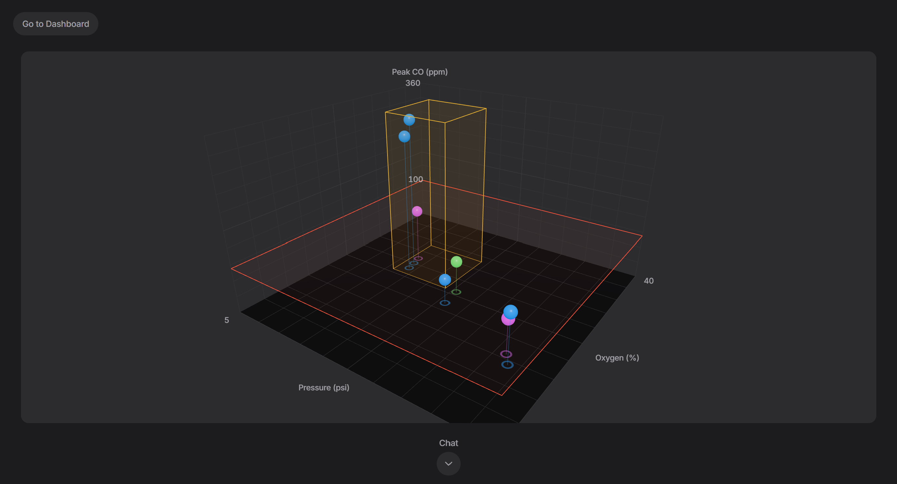
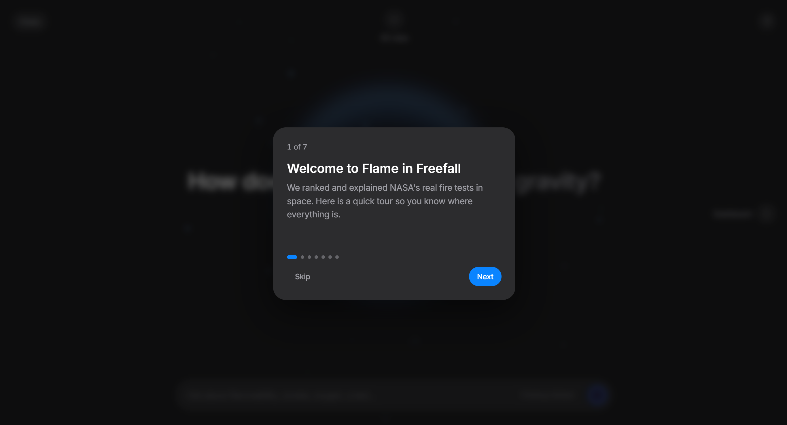
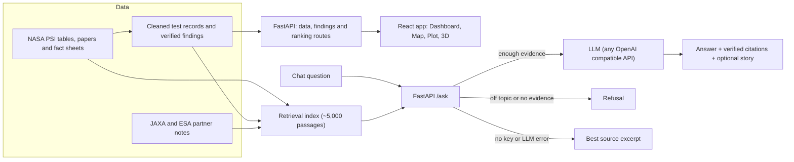
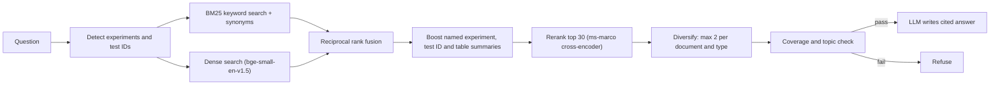

# Afterburn

**Ask NASA's fire experiments anything. Every answer cited.**

Team **Glitxh** · NASA International Space Apps Challenge 2026 · *Flame in Freefall* challenge

Fire behaves very differently in space. Without gravity, hot gas does not rise, so a candle flame becomes a dim blue ball instead of a yellow teardrop. NASA has studied this for decades on the Space Shuttle, Mir, the ISS and Cygnus cargo ships, but the results are spread across hundreds of documents, test tables and papers.

How does a flame behave when buoyancy-driven convection is reduced? Which spacecraft fire tests best match a given oxygen level and cabin pressure? Afterburn brings NASA experiment records, interactive charts, and a chat assistant with citations into one workspace: a chat that answers only from NASA's own data with citations to the exact paper and page, a dashboard that matches Moon and Mars habitat atmospheres to real NASA fire tests, and a 3D view of every test.

[Features](#features) · [Architecture](#architecture) · [Install](#install-and-run) · [Tutorial](#tutorial) · [Data](#data-and-provenance) · [API](#api-reference) · [Sources](SOURCES.md)

| Test records shown in Data | Source-checked findings | Investigations | Indexed passages |
| ---: | ---: | ---: | ---: |
| **2,000** | **891** (778 verified) | **24** | **~5,000** |

---

## Screenshots

Explore the main features of **Afterburn** through the screenshots below.

### 1. Chat - Ask NASA's Fire Experiments

Ask questions about NASA's fire experiments and receive evidence-based answers with citations to the original documents and page numbers.



### 2. Dashboard - Explore Fire Tests

The interactive dashboard lets you investigate NASA fire experiments under different atmospheric conditions.

| Dashboard | Map & Atmosphere |
|:---:|:---:|
|  |  |
| Explore the dashboard to investigate and compare NASA fire experiments. | Visualize and compare test conditions across different oxygen and pressure levels. |

### 3. 3D View - Visualize Fire Experiments

Explore Saffire experiments in an interactive 3D environment. Each test is positioned by oxygen concentration, cabin pressure and peak carbon monoxide increase.



### 4. Interactive Tutorial - A Guided Tour

Follow the built-in tutorial to discover the application's features, learn how to ask research questions, explore the dashboard and understand how to interpret experimental results.



---

## Features

### Chat: cited answers from NASA data
- **Answers only from NASA documents and data.** Every sentence carries a numbered citation. Hover a number to see the source document and page, and check the measurement against its original context.
- **Refuses instead of guessing.** Off-topic questions, or questions the data can't answer, get "The documents I have don't answer this." Citations to passages that don't exist are removed automatically.
- **Keeps gravity levels apart.** Microgravity (0 g) and normal gravity (1 g) results are reported separately, and Moon or Mars (partial gravity) values are never presented as measured.
- **Thinking levels.** Choose Default, Low (fastest), Medium or High (most careful) for each question.
- **"Why this matters" stories.** When a question connects to a real event (Apollo 1, Apollo 13, the 1997 Mir fire, NASA spinoffs, JAXA's FLARE), the chat offers a short story with what changed afterwards, what our data says, and a NASA source. 14 stories, each shown at most once per chat.
- **Scenario commands.** Type something like `32% oxygen at 9 psi` to set the cabin atmosphere for the whole app.
- **Answer cards.** Some answers add a chart, such as peak CO per Saffire test.
- **Saved chats.** Every conversation is saved in the browser and listed under **Chats**.

### Dashboard: real tests for your habitat
- **Habitat presets:** ISS (21% O₂, 14.7 psi), Moon base (30%, 10.2 psi), pressurized rover (34%, 8.2 psi) and Mars transit (26%, 10.2 psi), plus oxygen and pressure sliders.
- **Focus:** switch between **Prevention** (flame spread) and **Detection** (time to alarm) to see how the rankings change.
- **Adjustable score weights** with a transparent score breakdown.
- **Search bar (Ctrl + K):** find tests, experiments and findings, or ask the agent directly.

| Dashboard view | What you can do |
| --- | --- |
| **Ranking** | Find the Saffire IV to VI tests that best match the scenario and inspect the score breakdown. |
| **Map** | See the scenario alongside the tests in oxygen and pressure space. |
| **Plot** | Pick two measurements for a scatter plot. A test appears when it has values for both axes. |
| **Data** | Filter individual records by experiment, search text, oxygen and pressure. |
| **Findings** | Read the verified findings and open the associated investigation. |
| **Compare** | Inspect up to three selected tests side by side. |

### 3D view
- Every Saffire test placed by pressure, oxygen concentration and peak carbon monoxide increase. Rotate the view and hover a test to see its material and conditions.

### Look and feel
- The background flame switches between **In Space** (a dim blue ball) and **On Earth** (a teardrop), reacts to the chosen oxygen and pressure, and leans toward the mouse.
- A first-use **guide** (the **?** button) explains every part of the app.

---

## Components

| Folder | Component | What it does |
| --- | --- | --- |
| [`rag/`](rag) | **Retrieval engine** (`rag.py`) | Loads every document, splits it into passages, runs hybrid search and reranking, checks coverage, calls the LLM, verifies citations and picks stories. Also includes evaluation tools. |
| [`backend/`](backend) | **API** (FastAPI, `app.py`) | Serves the test data, findings and investigations, ranks tests for a scenario, and answers chat questions through the retrieval engine. |
| [`frontend/`](frontend) | **Web app** (React + Vite) | Chat, Dashboard and 3D view. Uses Tailwind CSS, Recharts for plots and charts, Three.js with React Three Fiber for 3D, Motion and Lucide icons. |
| [`PdfScraper/`](PdfScraper) | **Document parser** | Extracts structured findings (fuel, oxygen, pressure, spread rate, detection time, safety implications) from NASA PDFs with an LLM, then normalizes units. |
| [`data/`](data) | **Dataset** | Cleaned NASA test records, findings, investigations, papers, partner notes and stories. See [Data and provenance](#data-and-provenance). |

---

## Architecture



FastAPI serves the structured records and rankings to the React frontend. Search runs locally on your machine. Only the question and the retrieved passages are sent to the optional LLM for answer generation.

### How chat finds evidence



1. **Load and chunk.** The index includes papers, documents, spreadsheets, test records, findings and partner notes. PDFs are cleaned (repeated headers, author lines and reference lists removed) and split into passages of about 220 tokens. Every test row becomes its own passage, plus one summary passage per experiment with the ranges and counts of every column. Duplicate passages across files are merged.
2. **Hybrid search.** BM25 keyword search catches exact terms and test IDs. BGE embeddings catch related wording. Both rankings are fused 50/50. Embeddings are cached in `rag/.cache/`.
3. **Domain boosts.** Passages about the experiment or test named in the question are boosted, table summaries are boosted for "which / how many / range" questions, and requirement documents are pushed down unless the question is about hardware.
4. **Rerank and diversify.** A MiniLM cross-encoder reranks the top 30 when available, then at most 2 passages per document and type are kept, for 6 sources in total.
5. **Guard.** A rarity-weighted coverage score and a topic check refuse questions the documents don't cover, before any AI call.
6. **Answer.** The LLM gets strict rules: only use the numbered passages, cite every sentence, copy numbers exactly, keep 0 g and 1 g apart. Invalid citations are stripped, and calls are retried up to 3 times. The API returns source filenames and page numbers when a passage has page information.

### How ranking works

The default score allocates 100 points across three components:

```text
Maximum points per component   (each block = 5 points)

Oxygen match      █████████   45
Pressure match    ███████     35
Hazard indicator  ████        20
```

Oxygen and pressure matches decrease linearly with distance from the scenario. The oxygen component reaches zero at a difference of 12 percentage points, and the pressure component reaches zero at 7 psi. The hazard component uses measured flame spread or flame length growth for **Prevention** and time to alarm for **Detection**, scaled against the highest value for that mode.

The dashboard can reweight these components and rescales the total to a maximum of 100. Higher scores surface tests that fit the scenario and the selected priority. Use the scores to prioritize which sources to review. Engineering decisions require the original experimental conditions and independent validation.

---

## Install and run

**Requirements:** Python 3.12, Node.js 22 with npm, and Git.

### 1. Get the code

```bash
git clone https://github.com/8Glitchh/flame-in-freefall.git
cd flame-in-freefall
```

Run the backend and the frontend in two separate terminals, both starting from the repository root.

### 2. Backend

On Windows PowerShell:

```powershell
cd backend
py -3.12 -m venv .venv
.\.venv\Scripts\python.exe -m pip install -r requirements.txt
.\.venv\Scripts\python.exe -m uvicorn app:app --port 8000
```

On Linux or macOS:

```bash
cd backend
python3.12 -m venv .venv
.venv/bin/python -m pip install -r requirements.txt
.venv/bin/python -m uvicorn app:app --port 8000
```

The first start downloads the retrieval models and embeds all passages, which takes a few minutes. Later starts reuse the embeddings in `rag/.cache/`. Wait for `Application startup complete`, then open the interactive API docs at http://localhost:8000/docs.

### 3. Frontend

In a second terminal:

```bash
cd frontend
npm ci
npm run dev
```

Open http://localhost:5173. The frontend expects the API on port 8000.

### 4. AI answers (optional)

Without a key, chat still works: when retrieval finds enough evidence, it shows an excerpt from the highest ranked source. To get written answers:

1. Get a free API key at https://aistudio.google.com (no billing needed).
2. In the repository root, copy `.env.example` to `.env`:

```bash
copy .env.example .env
```

(On Linux or macOS: `cp .env.example .env`)

3. Put your key and a model available to your project in `.env`:

```dotenv
LLM_BASE_URL=https://generativelanguage.googleapis.com/v1beta/openai
LLM_API_KEY=your_gemini_key_here
LLM_MODEL=gemini-3.1-flash-lite
```

4. Restart the backend.

The backend appends `/chat/completions` to the base URL and sends the selected thinking level as `reasoning_effort`. A failed model call falls back to a source excerpt. Any OpenAI compatible provider works by changing these three lines (for example Groq: `LLM_BASE_URL=https://api.groq.com/openai/v1`, `LLM_MODEL=llama-3.3-70b-versatile`). See [Google's Gemini compatibility guide](https://ai.google.dev/gemini-api/docs/openai). `.env` is in `.gitignore`, so your key is never pushed.

---

## Tutorial

A 5-minute tour of everything the app can do.

### 1. Meet the flame
On the home screen, switch between **In Space** and **On Earth**. In space the flame becomes a dim blue ball because hot gas can't rise. Move your mouse and the flame leans toward it.

### 2. Ask a research question
Type in the chat box and press Enter:
```
How long did it take for the alarm to trigger in test VI-4?
```
The answer gives the exact time from the Saffire VI data, with a small citation number. **Hover the number** to see the source document, and check the measurement against its original context. A Peak CO chart appears under the answer. Another good one to try:
```
What smoke concentration triggered the alarm in SAFFIRE IV?
```

### 3. Hear the story behind the data
Ask:
```
How much did more oxygen speed up flame spread in the Saffire tests?
```
When **"Want to hear a story?"** appears above the input, click **Tell me** to read the related history, what changed afterwards and what our data says.

### 4. Try a harder question
Click **Thinking: Default** next to the input and choose **High**, then ask a comparison question such as:
```
In Saffire-II, how did burn length in microgravity compare with normal gravity?
```

### 5. See how it refuses
```
What is the best pizza in Amman?
```
It answers "The documents I have don't answer this." instead of making something up.

### 6. Set a habitat atmosphere
Type `32% oxygen at 9 psi` in the chat, or open the **Dashboard** (the right arrow at the screen edge, or the → key) and pick **Moon base**. The flame, the ranking and the map all update.

### 7. Follow the evidence in the dashboard
- **Ranking:** click a test to see why it scored the way it did. Switch **Prevention / Detection** and move the score weight sliders.
- **Map:** your scenario next to every test in oxygen and pressure space.
- **Data:** find a specific test by experiment, text, oxygen and pressure.
- **Plot:** chart any two measurements.
- **Findings:** read the research takeaways and open their investigation.
- **Compare:** put ranked tests side by side.
- Press **Ctrl + K** to search everything.

### 8. Explore in 3D
From Chat, use the up arrow (or **Go to 3D view** from the Dashboard). Drag to rotate and hover a test to see its material, oxygen, pressure and CO increase.

### 9. Come back later
All chats are saved under **Chats** (top left). Open the **?** button at any time for the guide.

---

## Data and provenance

| File or folder | Contents |
| --- | --- |
| [`data/psi_tests_clean.csv`](data/psi_tests_clean.csv) | The 22 NASA PSI test tables cleaned and merged: 2,016 rows, 263 standardized columns with units in the names. 2,000 rows are marked as data and shown in the dashboard (1,951 usable after 49 duplicates are removed), and 13 suspect values are flagged rather than silently changed. Every row keeps its source file, row and page. |
| [`data/findings/`](data/findings) | `psi_findings_source_checked.csv`: 891 findings extracted from 33 NASA documents. Each quote was matched against the source text: 778 matched and are used by chat, 113 could not be verified and are skipped. Also includes investigation summaries. |
| [`data/investigations.csv`](data/investigations.csv) | 24 combustion investigations with objective, approach, hypothesis, impacts, DOI and dates. |
| [`data/papers/`](data/papers) | PSI science documents, test matrices, data summaries, NASA fact sheets and the Combustion in Reduced Gravity Researcher's Guide. |
| [`data/experimental_tables/`](data/experimental_tables) | The original PSI test tables before cleaning. |
| [`data/partners.md`](data/partners.md) | Space agency partner research: JAXA's FLARE and Group Combustion experiments and ESA's fire safety work. |
| [`data/stories.json`](data/stories.json) | The 14 "Why this matters" stories, each with a NASA source. |
| [`data/background.md`](data/background.md) | Notes on the data sources and the history of fire in crewed spaceflight. |

The app preserves source file and row references for dashboard measurements. Some measurements are missing or approximate, so the number of tests in a plot depends on the chosen axes and filters. Pressure is stored in kPa and converted to psi for display where useful.

Every source used is listed in **[SOURCES.md](SOURCES.md)**. Cite each NASA investigation by its DOI, as listed in `data/investigations.csv`. Browse the original records in the [NASA Physical Sciences Informatics repository](https://psi.nasa.gov/physci/repo/).

---

## API reference

| Route | Purpose |
| --- | --- |
| `GET /data` | Dashboard test rows with units and provenance fields. |
| `GET /tests` | Tests with numeric oxygen and pressure values, filterable by range. |
| `GET /experiments` | Investigations, with optional category and fuel filters. |
| `GET /experiments/{psi_id}` | One investigation with its metadata, tests and findings. Also accepts an acronym. |
| `GET /findings` | Findings, filterable by theme, investigation and featured. |
| `POST /rank` | Rank Saffire tests for `o2` (%), `psi` and `need` (`prevention` or `detection`). |
| `POST /ask` | Answer a `question` with citations. Optional `thinking` (`low`, `medium`, `high`) and `shown` (story IDs already shown). Returns `answer`, `citations`, `mode`, `cited` and `story`. |

---

## Verify and evaluate

From the repository root on Linux or macOS (on Windows, use `backend\.venv\Scripts\python.exe` for the Python commands):

```bash
# Production frontend build
npm --prefix frontend run build

# Retrieval benchmarks (no API key needed)
backend/.venv/bin/python rag/rag.py
backend/.venv/bin/python rag/rag.py heldout

# Show the six passages retrieved for a question
backend/.venv/bin/python rag/rag.py search "What triggered the smoke alarm in SAFFIRE IV?"

# Full answer from the command line
backend/.venv/bin/python rag/rag.py ask "What fuels were tested in FLEX?"
```

| Test set | Correct passage ranked 1st | In top 6 | Off-topic refused |
| --- | ---: | ---: | ---: |
| Main (30 questions) | 21 | 28 | 2 / 2 |
| Held out, never tuned on (20 questions) | 14 | 17 | 2 / 2 |

The benchmarks measure retrieval: whether the expected evidence is in the passages given to the LLM, checked by matching source text. Generated answers and their citations should be evaluated separately.

---

## Use of AI

- AI coding assistants (Claude, GitHub Copilot) helped write parts of the code, including the retrieval pipeline.
- The findings in `data/findings` were extracted from NASA documents with an LLM (via LiteLLM), and each quote was checked against the source text.
- The app uses an OpenAI compatible LLM API (Google Gemini in our demo) to write answers from retrieved NASA passages.
- The demo video's end card and thumbnail are AI generated and watermarked.

---

## Team

| Name | Role |
| --- | --- |
| Ahmed | Team lead, RAG |
| Ali | Backend, frontend |
| Aref | Data science, frontend |
| Gaith | Data science, backend |
| Noor | Scientific research and fact checking |

## Credits and license

Built by **Team Glitxh** for the 2026 NASA International Space Apps Challenge. The code is released under the [MIT License](LICENSE). The original research and experimental data are credited to NASA and the researchers named in the source documents. Partner information comes from JAXA and ESA. NASA, JAXA and ESA do not endorse this project. Full list of sources: [SOURCES.md](SOURCES.md).
